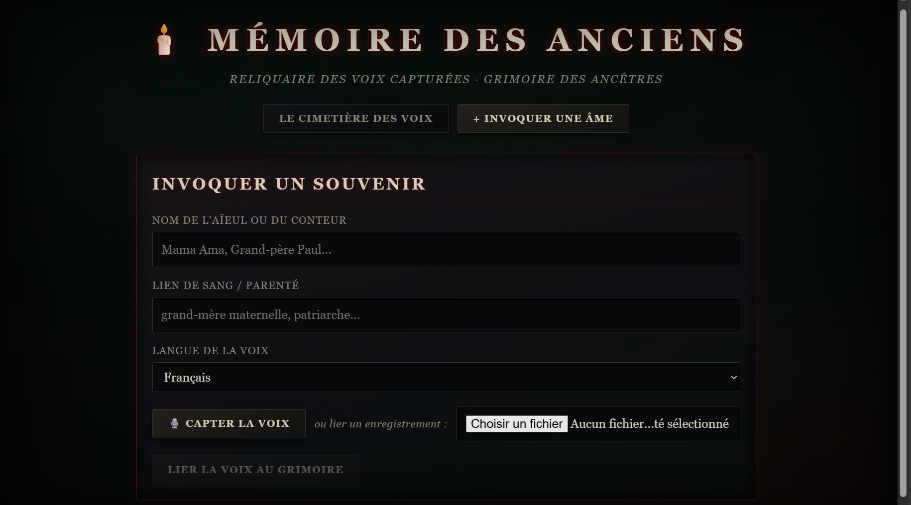

# 🕯️ Mémoire des Anciens

Préservez les histoires orales de famille : enregistrez (ou téléversez) un proche qui raconte un souvenir,
l'app le transcrit puis génère une **page-souvenir**. **100 % local** : faster-whisper + Gemma via Ollama,
aucun appel à un service cloud.


<!-- Ajoutez votre capture : lancez l'app, ouvrez http://localhost:8000, puis enregistrez docs/capture.png -->

## Installation
Prérequis : Python 3.11+, [Ollama](https://ollama.com), ffmpeg conseillé.
```bash
python -m venv .venv && source .venv/bin/activate   # Windows : .venv\Scripts\activate
pip install -r requirements.txt
ollama pull gemma3
```
Le modèle Whisper « tiny » (~75 Mo, rapide ; passez `WHISPER_MODEL=small` pour plus de précision) se télécharge **une seule fois** au premier usage ; ensuite tout fonctionne hors ligne.

## Lancement
```bash
ollama serve                      # si Ollama n'est pas déjà lancé
uvicorn main:app --port 8000      # puis ouvrir http://localhost:8000
```
Variables optionnelles : `OLLAMA_MODEL` (défaut `gemma3`), `OLLAMA_URL`, `WHISPER_MODEL` (défaut `tiny`).

## Utilisation
1. « Nouveau souvenir » : nom du conteur, parenté, langue, puis micro ou fichier (mp3, wav, m4a, webm).
2. Suivez la progression ; la page-souvenir s'ouvre (résumé, portrait, personnes, lieux, dates, paroles à garder, audio).
3. « Ofrenda » = galerie de tous les souvenirs ; « Exporter » = fichier Markdown.

Données : `./data/<id>.json` + `./data/<id>.<audio>`. Si Ollama est éteint ou renvoie un JSON invalide
(un second essai est fait), la transcription brute est conservée et affichée.

## Tests
```bash
pytest -q                                      # logique + API, modèles simulés (rapide)
python -m services.transcription mon_audio.mp3 fr   # transcription seule en CLI
```
`tests/test_app.py` génère son audio d'exemple (`sample_wav`). Pour un test réel de bout en bout,
enregistrez 10 s de voix dans `tests/exemple.wav` et lancez la CLI ci-dessus.

## Limites connues
Whisper ne gère pas l'éwé ni le kabiyè : la langue est alors détectée automatiquement, la qualité peut être faible.
Le micro du navigateur exige `localhost` ou HTTPS.
